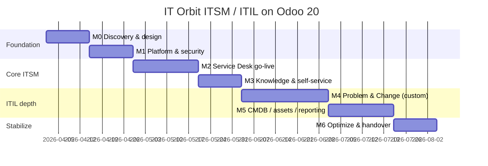

# ITIL / ITSM on Odoo 20 — Roadmap for IT Orbit (مدارگسترش)

**Verdict:** Use Odoo Enterprise **Helpdesk + Knowledge + Project/Maintenance** as the Service Desk core, then close ITIL gaps (Problem, Change/CAB, CMDB, KEDB) with a custom `my-addons` ITSM layer. Roll out in **6 milestones over ~16–20 weeks**.

---

## Scope & design principle

| ITIL practice | Odoo 20 native fit | Approach |
|---|---|---|
| Incident / Service Request | **Helpdesk** (teams, stages, SLA, portal, email) | Configure |
| Knowledge / KEDB seed | **Knowledge** + `website_helpdesk_knowledge` | Configure |
| Service Catalog (light) | Helpdesk ticket types/tags + Website forms | Configure |
| Continuity / assets (ops) | **Maintenance** + inventory/assets | Configure + light custom |
| Problem Management | Weak / not first-class | Custom module |
| Change + CAB | Weak (Project can approximate) | Custom module |
| CMDB / CI relationships | Not native ITSM CMDB | Custom or phased later |
| Continual Improvement | Reporting + Project | Process + dashboards |

**Decision gate (Milestone 0):** either (A) native Helpdesk-first + custom ITIL add-on, or (B) buy a third-party Odoo ITSM app. For IT Orbit (products: Orbit@ll, EPIC, ACE, Citadel, NAD), **A** keeps control and matches your `my-addons` pattern.

---

## Milestone map

---

## M0 — Discovery & solution design (Week 1–2)

**Goal:** Agree ITIL scope, audiences, and Odoo module map before building.

| # | Task | Output |
|---|---|---|
| 0.1 | Stakeholder workshops (IT ops, support, product owners for Orbit@ll/EPIC/ACE/Citadel/NAD, management) | RACI + service owners |
| 0.2 | Inventory current channels (email, phone, Telegram/WhatsApp, portal, walk-in) | Intake matrix |
| 0.3 | Define services & catalogs (internal IT vs customer support per product) | Service Catalog v1 |
| 0.4 | Define ticket taxonomy: Incident / Request / Complaint / Access / Change request | Type/tag dictionary |
| 0.5 | Draft SLA classes (P1–P4 × business hours) | SLA policy sheet |
| 0.6 | Gap analysis: Helpdesk vs full ITIL (Problem/Change/CMDB) | Build vs buy decision |
| 0.7 | Target architecture (DB, teams, security groups, Persian UX) | Architecture one-pager |
| 0.8 | Success KPIs (FCR, MTTA, MTTR, SLA %, CSAT, reopen rate) | KPI dashboard spec |

**Exit criteria:** Signed scope — Phase 1 = Incident + Request + SLA + Knowledge; Phase 2 = Problem + Change; Phase 3 = CMDB.

---

## M1 — Platform foundation (Week 3–4)

**Goal:** Odoo 20 ready for Helpdesk with correct company, security, and integrations.

| # | Task | Odoo / work |
|---|---|---|
| 1.1 | Confirm Enterprise addons path & license on target env (server2 / IT Orbit DB) | Deploy checklist |
| 1.2 | Install core apps: `helpdesk`, `website_helpdesk`, `knowledge`, `website_helpdesk_knowledge`, `project`, `project_helpdesk`, `helpdesk_timesheet`, `maintenance` (as needed) | Apps |
| 1.3 | Company, working calendars (Iran business hours), users, departments | Settings |
| 1.4 | Security groups: Agent, Team Lead, Problem Manager, Change Manager, CAB, Knowledge Editor, Portal Customer | Access rights |
| 1.5 | Mail aliases per team (`support@…`, `itsm@…`) + catch-all rules | Email → ticket |
| 1.6 | Multi-team design: Internal IT / Product Support (per product or shared L1→L2) | Helpdesk teams |
| 1.7 | Staging DB + UAT users; backup & upgrade procedure for custom addons | Ops runbook |
| 1.8 | FA localization / RTL sanity on Helpdesk & portal | UX check |

**Exit criteria:** Tickets creatable by email and UI; roles cannot see wrong teams.

---

## M2 — Service Desk (Incident & Request) go-live (Week 5–7)

**Goal:** Replace ad-hoc email/spreadsheets with controlled ticket lifecycle + SLA.

| # | Task | Detail |
|---|---|---|
| 2.1 | Stages per team (e.g. New → Triage → In Progress → Waiting Customer → On Hold → Resolved → Closed) | Pause SLA on On Hold / Waiting |
| 2.2 | Priority model (Impact × Urgency → P1–P4) — start as tags/stars; later automate in custom | Priority matrix |
| 2.3 | SLA policies (response + resolution targets by priority/team) | Helpdesk SLA |
| 2.4 | Assignment: round-robin / balanced / manual for L2 specialists | Team settings |
| 2.5 | Automations: escalate on SLA risk, notify leads, reopen rules | Automated actions |
| 2.6 | Portal: customers/employees submit & track tickets | Website Helpdesk |
| 2.7 | Ratings after close; CSAT loop | Portal rating |
| 2.8 | Pilot with 1–2 teams (e.g. Internal IT + NAD support) for 2 weeks | Pilot report |
| 2.9 | Cutover: freeze old channels or forward them into aliases | Go-live |

**Exit criteria:** ≥80% of new incidents/requests in Odoo; SLA timers visible; daily standup from Helpdesk kanban.

---

## M3 — Knowledge & self-service (Week 8–9)

**Goal:** Reduce ticket volume; seed Known Error Database culture.

| # | Task | Detail |
|---|---|---|
| 3.1 | Knowledge workspaces: Internal SOPs, Product FAQs, Known Errors | Knowledge |
| 3.2 | Link articles to Helpdesk; suggest articles on ticket form | `website_helpdesk_knowledge` |
| 3.3 | Publish top 20 FAQs from pilot tickets | Content pack |
| 3.4 | Optional: eLearning/slides for agent onboarding | `website_helpdesk_slides` |
| 3.5 | Optional: Livechat → ticket for L1 | `website_helpdesk_livechat` |
| 3.6 | Process rule: every Resolved ticket with reusable fix → draft KB article | Operating procedure |

**Exit criteria:** Agents open KB from tickets; ≥10 published articles; portal self-help live.

---

## M4 — Problem & Change Management (custom ITIL) (Week 10–13)

**Goal:** Close the main ITIL gap with a first-party addon under `my-addons` (e.g. `itorbit_itsm`).

| # | Task | Deliverable |
|---|---|---|
| 4.1 | Spec models: `itsm.problem`, `itsm.change`, links to `helpdesk.ticket` | Technical design |
| 4.2 | Problem workflow: Detect → Investigate → Known Error → Workaround → Root Cause → Closed | Stages + security |
| 4.3 | Link many Incidents → one Problem; push workaround to Knowledge (KEDB) | Smart buttons |
| 4.4 | Change types: Standard / Normal / Emergency | Change form |
| 4.5 | Risk assessment + CAB approval (Approvals / activities) for Normal/Emergency | Approval flow |
| 4.6 | Implementation window, rollback plan, PIR (post-implementation review) | Fields + checklist |
| 4.7 | Convert Helpdesk ticket → Problem / Change wizard | UX |
| 4.8 | Optional: Project/task for implementation work | `project_helpdesk` bridge |
| 4.9 | UAT + train Problem Managers / CAB | Training pack |
| 4.10 | Soft go-live for Change on production changes only | Policy |

**Exit criteria:** Recurring incidents create Problems; no production change without recorded Change (except documented emergency path).

---

## M5 — Assets, CMDB-lite & management reporting (Week 14–16)

**Goal:** Configuration visibility and ITSM governance dashboards.

| # | Task | Approach |
|---|---|---|
| 5.1 | CMDB-lite: CI types (Server, App, DB, Network, Service, Product Module) | Custom `itsm.ci` or Maintenance equipment |
| 5.2 | Link CI ↔ Ticket / Problem / Change | Many2many |
| 5.3 | Asset lifecycle via Maintenance (warranty, vendor, location) | Maintenance |
| 5.4 | Service health views per product (Orbit@ll, EPIC, …) | Filters/tags |
| 5.5 | Executive dashboards: volume, SLA, MTTR, top problems, change success rate | Spreadsheet/Pivot + Studio if needed |
| 5.6 | Continual Improvement backlog (Project or Helpdesk type “Improvement”) | CSI process |
| 5.7 | Integrations (optional later): monitoring alerts → tickets, AD/LDAP users | Backlog only unless critical |

**Exit criteria:** Major services have CI records; monthly ITSM report auto-generated from Odoo.

---

## M6 — Stabilize, train, handover (Week 17–18)

| # | Task | Output |
|---|---|---|
| 6.1 | Agent & lead training (FA playbooks) | SOPs |
| 6.2 | CAB charter & meeting cadence | Governance doc |
| 6.3 | Tune SLAs from real data | SLA v2 |
| 6.4 | Performance review vs M0 KPIs | Scorecard |
| 6.5 | Hardening: access review, audit trail, backup of custom module | Ops checklist |
| 6.6 | Roadmap backlog (full CMDB graph, monitoring, AI triage via your AI provider) | Phase 4 backlog |

---

## Suggested Odoo module stack (IT Orbit)

**Phase 1 (must):**  
`helpdesk`, `website_helpdesk`, `knowledge`, `website_helpdesk_knowledge`, `mail`/aliases, calendar/resource for working hours

**Phase 1 (recommended):**  
`project`, `project_helpdesk`, `helpdesk_timesheet`, `helpdesk_sms` (if SMS used)

**Phase 2+:**  
Custom `itorbit_itsm` (Problem, Change, CI), `maintenance`, optional livechat/slides

**Out of scope for first wave:** full MSP billing, deep Zabbix-style CMDB, replacing product platforms (EPIC/ACE) with Odoo BPM.

---

## Governance & roles (assign early)

| Role | Responsibility |
|---|---|
| Sponsor (IT Orbit mgmt) | Priorities, CAB authority |
| Service Owner (per product) | Catalog, SLAs, accept changes |
| Service Desk Lead | Day-to-day Helpdesk |
| Problem Manager | Major incident → problem |
| Change Manager / CAB | Risk & schedule |
| Odoo Solution Architect | Module design, custom addon |
| Odoo Technical Lead | `my-addons`, deploy, security |

---

## Risks to manage

1. **Treating Helpdesk alone as “ITIL done”** — without Problem/Change, you only have a ticket tool.  
2. **Too many teams/stages at day one** — start with 2 teams, simplify stages.  
3. **SLA without business hours / On Hold rules** — false breaches destroy trust.  
4. **KB empty at go-live** — mandate article creation from pilot tickets.  
5. **Custom CMDB over-engineering** — CI-lite first; graph CMDB later.

---

## Immediate next tasks (what to start this week)

1. Run M0 workshops and freeze Service Catalog + SLA matrix.  
2. Confirm Enterprise Helpdesk availability on the IT Orbit Odoo 20 instance.  
3. Decide **build `itorbit_itsm`** vs third-party ITSM (recommend build if you want ITIL naming and product-linked CIs).  
4. Stand up staging with Helpdesk + Knowledge and one pilot team.  
5. Draft ADR: “ITIL on Odoo 20 — Helpdesk core + custom Problem/Change/CMDB-lite”.

---

If you want this turned into a project plan file (milestones with owners/dates) or a technical ADR for `itorbit_itsm` models, switch to Agent mode and say which format you prefer.